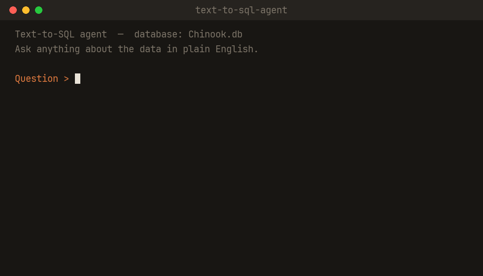

# Text-to-SQL Agent

[](https://github.com/lilwan345/text-to-sql-agent/actions/workflows/tests.yml)


[](LICENSE)

Ask a database a question in plain English. A Claude tool-calling agent writes
the SQL, runs it read-only, reads its own errors and fixes them, then
double-checks its answer before giving it to you.

I built it to learn how AI agents actually work, then tested it the way I'd
test a BI tool before trusting it: against answers I computed myself, plus a
set of questions designed to make it fail.



*A real run on the included Chinook sample database: the agent writes the SQL,
runs it read-only, and double-checks its own answer.*

## Results

| Test set | What it probes | Result |
|---|---|---|
| **Clean benchmark** (10 questions) | simple counts up to 4-table joins | **10/10** correct answers |
| **Adversarial set** (8 questions) | synonym traps, date filters, NULLs, empty results, multi-step math, vague metrics | **8/8** correct SQL, and **one real failure mode** found |

Every expected answer comes from my own SQL against the database, not from
the model. Those expected values are themselves checked by a test, so a typo
in the answer key can't hide a wrong answer.

**The failure mode.** On vague questions ("Who is the best-selling artist?",
by copies sold or by revenue?) the agent quietly picks one reading and answers
confidently, without saying which one it chose. In this case both readings
happen to give Iron Maiden, so the answer looks right, but the agent never
told you it made a choice. For a self-serve BI tool that's the risk that
matters most, because different people mean different things by "best". The
fix I'd try first is a prompt-level rule: when a question can be read more
than one way, say which reading you picked, or ask instead of guessing.

## How it works


1. The database schema (every `CREATE TABLE`) goes into the system prompt, so
   Claude writes SQL against real table and column names instead of guessing.
2. Claude gets one tool, `run_sql`. It decides what to query, and when it has
   enough to answer.
3. If a query fails, the SQLite error goes back to Claude as a tool error and
   it rewrites the query.
4. Once it answers, a second "judge" call reviews the question, the SQL that
   actually ran, and the answer, and adds a warning if they don't line up
   (for example, sorting by price when the question asked about length).

The part I think is cool: I don't parse the SQL or decide when to stop.
Claude does that itself by choosing whether to run another query or just
answer. That's what makes it an agent and not just one API call.

## Guardrails

- **Read-only, enforced twice.** Every query has to be a single `SELECT` (or
  `WITH`) with no write keywords, and the database is also opened in SQLite's
  read-only mode, so even if something slipped past my check, SQLite blocks it.
  I added the second layer because I didn't fully trust my first one, and
  there's a test that turns the first layer off to prove the second still holds.
- **Errors become feedback, not crashes.** SQL errors go back to Claude;
  busy or rate-limited API responses are retried with backoff (1s, 2s, 4s),
  while real errors like a bad API key fail right away.
- **Bounded.** At most 6 tool steps per question, and at most 200 rows sent
  back per query, with a note telling Claude to aggregate instead.
- **Memory that can't get corrupted.** You can ask follow-ups because the
  conversation is kept between questions. If a question fails halfway, its
  messages are rolled back so the next question still works.

## Run it

```bash
python3 -m venv .venv
./.venv/bin/pip install -r requirements.txt

cp .env.example .env        # paste your Anthropic API key into .env
./.venv/bin/python agent.py
```

Get a key at https://console.anthropic.com. The `.env` file is gitignored, so
the key never ends up on GitHub. It comes with the Chinook sample database (a
fake music store), so you can ask things like:

```
Question > How many customers are from the USA?
Question > What is the total revenue from the Rock genre?
Question > Now break that down by year.
```

Commands: `clear` (forget the conversation), `verify on` / `verify off` (turn
the self-check on or off), `quit`.

**Your own data.** Turn a CSV into a database file and point the agent at it,
no code changes needed:

```bash
./.venv/bin/python csv_to_db.py mydata.csv   # makes mydata.db
./.venv/bin/python agent.py mydata.db
```

## Testing

There are two kinds of tests.

**Offline tests (no API key, run in CI on every push):**

```bash
./.venv/bin/pip install pytest
./.venv/bin/python -m pytest tests/
```

48 tests covering both read-only layers, the agent loop (driven by a fake
client that plays back scripted Claude replies: tool calls, SQL errors,
refused writes, the step cap, the self-check, retries), the CSV converter, and
the answer key.

**Live evals (real API calls, a few cents):**

```bash
./.venv/bin/python eval_accuracy.py      # scores the 10 clean questions
./.venv/bin/python eval_adversarial.py   # the 8 tricky ones, judged by hand
```

The adversarial questions are judged by hand on purpose. For some of them the
right behavior isn't a number, it's "say which assumption you made" or "ask".

## Limitations

- The whole schema goes into the prompt, so a database with hundreds of tables
  wouldn't fit. The next step would be retrieving only the relevant tables.
- The CSV converter stores every column as text, so messy values like `$24.99`
  would break math on them.
- The self-check uses the same kind of model, so it can miss the same things
  the agent misses. It turns silent mistakes into flagged ones; it doesn't
  guarantee correctness.
- The ambiguity guardrail above is proposed, not built yet.

## Project layout

```
agent.py              the agent: schema injection, run_sql tool, loop, self-check, CLI
csv_to_db.py          CSV -> one-table SQLite file
eval_accuracy.py      live eval: 10 questions, scored against the answer key
eval_adversarial.py   live eval: 8 questions built to expose failure modes
tests/                offline pytest suite (fake client, no API key)
Chinook.db            sample database (a fake music store)
assets/               demo GIF and workflow diagram
```

## Built with

Python, the Anthropic API (Claude, tool use), and SQLite. Sample data is the
[Chinook database](https://github.com/lerocha/chinook-database).

MIT licensed, see [LICENSE](LICENSE).
